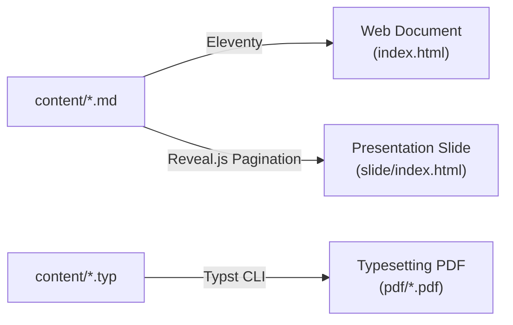

# 📦 Node.js 생태계의 Content Packaging Boilerplate
> MD to HTML (Eleventy + Reveal.js) and TYP to PDF
> 
> Eleventy(Web SSG), Reveal.js(Web Slide), Typst(Typesetting PDF)를 Single Source Pipeline으로 결합한 초경량 Content Boilerplate

인공지능 이해를 위한 기초수학 교과서를 주제로 구축되었으며, 단일 Markdown 원고에서 반응형 Web 문서와 발표용 Slide를 자동 빌드하고, 심화 조판 엔진인 Typst를 통해 인쇄용 PDF를 동시 생성하여 유기적으로 연결한다.

[🌐 배포 사이트 미리보기 (Netlify)](https://lab-eleventy-libdoc.netlify.app)

---

## 🎯 설계 목적 및 3단 Hybrid Pipeline

Document Tools의 과도한 directory depth와 복잡한 추상화를 걷어내고, content creator가 단일 폴더(`content/`)에서 글을 작성하면 3가지 형태의 최종 output으로 자동 변환된다:



1. [총론 (Web Document)]: Eleventy (`content/*.md` ➔ `_site/.../index.html`)
   - Desktop/Mobile 반응형 Web 문서로 빠른 탐색 및 스크롤 학습 지원.
   - Bauhaus UI 기반 단원 Navigation, KaTeX 수식 rendering, 실시간 Client Search.
2. [강의 슬라이드 (Presentation)]: Reveal.js (`src/slides.liquid` ➔ `_site/.../slide/index.html`)
   - Markdown 파일 수정 없이 Global Pagination을 통해 자동 생성되는 전체 화면 Presentation.
   - 수평선 separator(`---`) 기반 Slide 자동 분할, Bauhaus Slide Theme, `Esc` 본문 복귀 shortcut.
3. [각론 (Typesetting PDF)]: Typst (`content/*.typ` ➔ `_site/pdf/*.pdf`)
   - LaTeX급 수식 typesetting engine 기반 고품질 인쇄/다운로드용 교재.
   - CI/CD 환경 한글 font 자동 확보 pipeline 내장.

---

## 🛠 Technical Stacks

- SSG Engine: [Eleventy (11ty) v3](https://www.11ty.dev/) (ESM 기반 build)
- Slide Engine: [Reveal.js v5](https://revealjs.com/) (CDN 기반 Vanilla Web Presentation)
- Typesetting Engine: [Typst v0.15+](https://typst.app/) (C++ 기반 초고속 PDF Typesetting Compiler)
- 수식 Rendering: `markdown-it` + `markdown-it-katex` / KaTeX (Web 및 Slide Native 수식)
- Styling: Vanilla CSS (Bauhaus 삼원색 `#D82B27`, `#185ADB`, `#F4B41A` 기반 Design System)
- Search Engine: 정적 `search.json` 기반 Vanilla Client Search (Shortcut `/`)
- Deploy: Netlify (독립 Typst binary 및 한글 font pipeline 자동 연동)

---

## 📁 Directory Structure

모든 학습 content 원본은 `content/` directory에 단원명 기준으로 일관되게 배치된다:

```text
lab-netlify-eleventy/
├── .eleventy.js           # Eleventy 핵심 설정 (KaTeX, Image path 보정, Collection, Copy 규칙)
├── .eleventyignore        # Build 제외 목록 (typ, bin, scripts 등)
├── package.json           # Build script pipeline 정의
├── netlify.toml           # Netlify deploy build 환경 설정
│
├── content/               # 📦 [Source Content] 단원별 Markdown(Web/Slide) 및 조판 source(PDF)
│   ├── index.md           # 대문 / Overview
│   ├── 01-정보 윤리.md     # Web 총론 & Slide 원고
│   ├── 01-정보 윤리.typ    # 심화 조판 각론 Typst source
│   ├── 04-자료-이미지-영상.md
│   ├── 04-자료-이미지-영상.typ
│   └── 04-자료-이미지-영상/ # 단원별 Image directory
│
├── src/                   # 🎨 [Web UI Layout & Template]
│   ├── _includes/
│   │   ├── base.liquid    # 기본 HTML Frame, Header, Sidebar, Search Modal
│   │   └── page.liquid    # Web 본문 Template + Header 인라인 버튼 (Slide, PDF)
│   ├── slides.liquid      # 💡 [핵심] 단원 Collection을 순회하며 /slide/ HTML을 일괄 생성
│   ├── slides.css         # 🎛️ Slide Header 및 본문 Font Size 컨트롤러 (기존 대비 80% 기본값)
│   ├── search.json.liquid # 실시간 Search Index Template
│   └── assets/
│       ├── css/
│       │   ├── bauhaus.css        # Web 총론용 Bauhaus Design System
│       │   └── bauhaus-reveal.css # Reveal.js Slide용 Bauhaus Custom Theme
│       └── js/
│           ├── theme.js   # Theme Toggler
│           └── search.js  # 실시간 Search Script
│
├── typst/                 # 📐 [Typst 조판 Template, Font & Scripts]
│   ├── templates/
│   │   ├── textbook.typ   # 교재/강의노트용 Bauhaus Template
│   │   └── paper.typ      # 심화 논문/Article용 Template
│   ├── fonts/             # 다운로드된 CJK 한글 Font (Git 제외)
│   └── scripts/
│       ├── ensure-typst.sh # Platform별 Typst Binary 자동 다운로드 및 검증
│       ├── ensure-fonts.sh # 기본 CJK 한글 Font(Noto Sans KR) 자동 확보
│       └── build-pdf.sh   # content/*.typ 파일들을 _site/pdf/*.pdf로 일괄 compile
│
└── _site/                 # 🚀 [최종 Deploy Output]
    ├── content/...
    │   ├── 01-정보-윤리/
    │   │   ├── index.html       # 📝 Web 총론 Page
    │   │   └── slide/
    │   │       └── index.html   # 📽️ Reveal.js Slide Page
    └── pdf/                     # 📄 Typst compile PDF 모음
        ├── 01-정보 윤리.pdf
        └── 04-자료-이미지-영상.pdf
```

---

## 🚀 사용법 (Usage & Workflow)

### 1. 사전 준비 및 Dependency 설치
Node.js 20+ 환경에서 다음 명령어로 의존성을 설치한다:
```bash
npm install
```

### 2. Local Live Reload 개발
Incremental build(`--incremental`)가 적용된 Local Dev Server를 구동한다:
```bash
npm run dev
```
- 서버 주소: `http://localhost:8080/`
- Markdown, CSS, Template 수정 시 `0.1~0.2초` 내에 변경사항이 Web과 Slide에 동시 반영된다.

### 3. Typst PDF 각론 조판 Build
Typst CLI와 한글 Font가 환경에 없어도 `typst/scripts/ensure-typst.sh`와 `typst/scripts/ensure-fonts.sh`가 Linux Binary와 기본 한글 Font(Noto Sans KR Variable)를 자동 확보하여 compile을 수행한다:
```bash
npm run build:pdf
```
- `content/*.typ`의 모든 조판 source가 `_site/pdf/*.pdf`로 일괄 compile된다.

### 4. Production 통합 Build
Netlify CI 환경에서 실행되는 전체 build command:
```bash
npm run build
```
- `npm run build:pdf` → `npm run build:site` 순서로 실행되어 Web HTML, Reveal.js Slide, PDF 파일이 `_site/` directory에 생성된다.

---

## 📝 Slide 및 각론 연동 Guide

### 1. Slide Separator 작성법
Markdown 원고 작성 시 표준 수평선(`---`)을 삽입하면 Reveal.js Slide가 자동으로 분할된다:
- `---`: Horizontal 새 Slide 생성
- `--`: Vertical 하위 Slide 생성 (보충 설명용)
- `Note:`: Speaker Note (Slide 화면에서 `s` 키를 누르면 Speaker View 실행)
- `Esc` 키: 발표 도중 원래 Web 총론 Page로 즉시 복귀

### 2. Web 총론 상단 Slide 및 PDF (Detailed) 버튼 자동 연동
Markdown 문서 상단 Frontmatter에 `pdf: "파일명.pdf"` property를 지정하면, 해당 Web Page 상단 `CHAPTER` 태그 옆에 [📽️ Slide] 버튼과 [📄 PDF (Detailed)] 버튼이 인라인으로 자동 rendering된다:

```markdown
---
title: "01-정보 윤리"
description: "정보기술의 발전과 사회적 변화, 개인정보 유출과 저작권 보호"
eleventyNavigation:
  key: "01-정보 윤리"
  order: 1
pdf: "01-정보 윤리.pdf"
---

# 01-정보 윤리
정보기술 정의 및 인트로...

---

### 정보기술의 발전과 사회
슬라이드로 나뉠 본문 내용...
```